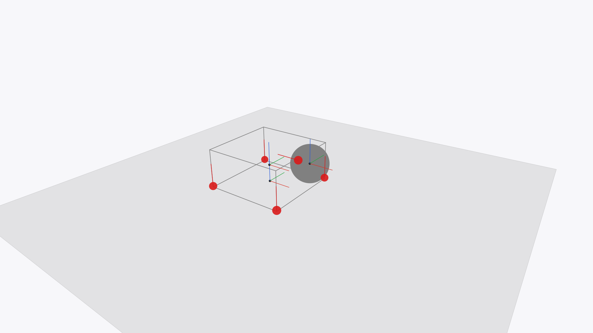

# mjc — a differentiable physics engine on the Raven stack

`mjc` computes what MuJoCo computes: soft-constraint contact dynamics from a
compiled model, stepped in a tensor program. It is written in OCaml on `nx`
and `rune`, has no C library underneath, and is differentiable through the
whole step with `Rune.grad`.

## Status



*`mjc-view` on the `blocks` corpus: a box and a sphere on a plane, with
contact points, body frames and the plane drawn through the scene IR.*

**M4 in progress.** Contact detection (plane-sphere, plane-capsule,
sphere-sphere, sphere-capsule) matches MuJoCo at 1e-12, and frictionless
contact rows are solved. Frictional contacts and the compiled path for models
that collide are not in yet.

**M3 complete, short of tendons and motors.** Limits, equality constraints and
friction loss are solved and match MuJoCo to machine precision; both the Euler
and the implicitfast integrators are in. Friction-loss rows are solved as box
constraints, with
both the saturated and the quadratic branch in the corpus. Equality rows
(connect, weld, joint) are assembled and
solved, and match MuJoCo to 1e-12 across rows, Jacobian, impedance, reference
acceleration and force. Joint limits are solved: the rows and the impedance match
MuJoCo to 1e-12, the solved force to 1e-6, and a constrained trajectory to
1e-6 over ten steps. The solver runs as an active-set Newton, with CG behind
the same loop agreeing to 1e-8. Equality constraints and friction loss are
next.

**M2 complete.** Forward kinematics, the mass matrix, the velocity stage, the
bias force, springs and dampers, and the semi-implicit Euler step match MuJoCo
3.17 on a four-model parity corpus: the stage arrays to 1e-12, and ten steps
of the whole engine to 1e-10. A compiled step costs about 30 us. The library
is private and has no `(package ...)` stanza yet, so it cannot be depended on
from outside this repository. The G0 linear-algebra gate passes with margin:
[`doc/spike-la.md`](doc/spike-la.md). What exists, and what each milestone
measured, is in [`doc/log.md`](doc/log.md).

Try it:

```sh
dune exec packages/mjc/tools/inspect.exe -- packages/mjc/test/fixtures/ball.mjcb --fk
dune build @packages/mjc/runtest        # 16 fast suites, ~10 s once built
dune build @packages/mjc/runtest-slow   # the parity gate and the exhaustive
                                        # box-box manifolds, ~2 min; also nightly
```

`runtest` is what CI runs on every push. `runtest-slow` holds the suites that are
too slow to run on every edit and too important to drop: the box-box manifold
comparison (800 pairs, every contact matched as a set) and hopper, walker and
humanoid against 1000 recorded MuJoCo states each. It runs nightly.

## Your first model, in five steps

**1. Write it** in MJCF, as you would for MuJoCo. A cart on a rail with a pole:

```xml
<mujoco model="cartpole">
  <option timestep="0.005"/>
  <worldbody>
    <geom name="floor" type="plane" size="2 2 0.1"/>
    <body name="cart" pos="0 0 0.1">
      <joint name="slide" type="slide" axis="1 0 0"/>
      <geom type="box" size="0.1 0.05 0.05" mass="1"/>
      <body name="pole" pos="0 0 0.05">
        <joint name="hinge" type="hinge" axis="0 1 0"/>
        <geom type="capsule" fromto="0 0 0 0 0 0.5" size="0.02" mass="0.1"/>
      </body>
    </body>
  </worldbody>
  <actuator><motor joint="slide" ctrlrange="-10 10"/></actuator>
</mujoco>
```

**2. Compile it** with MuJoCo, once, at development time. The converter is a
library, not a binary, so this is the whole of it — `mjc` itself never needs
MuJoCo installed:

```sh
python3 -c "import mujoco, sys; sys.path.insert(0, 'packages/mjc/tools'); \
            import mjcb; m = mujoco.MjModel.from_xml_path('cartpole.xml'); \
            mujoco.mj_setConst(m, mujoco.MjData(m)); \
            mjcb.write_model(m, 'cartpole.mjcb')"
```

**3. Load and step it.** `packages/mjc/example/hello.ml` is a complete program that
does the five things, and CI builds and runs it:

```sh
dune exec packages/mjc/example/hello.exe -- /tmp/cartpole.mjcb
```

```text
loaded /tmp/cartpole.mjcb: nq = 2, nv = 2, nbody = 3, timestep = 0.005 s
after 100 steps: t = 0.500 s, qpos = [0.0000, 0.0000]
  d(sum qpos)/d(gravity) = [2.5e-05, -0, -0]
  d(sum qpos)/d(dof_damping) = [0, -0]
  d(sum qpos)/d(body_mass) = [0, 0, 0]
  (the step it differentiated reached sum qpos = 0.000000000)
  check: d(sum qpos)/d(gravity_z): central difference 0, reverse mode -0, relative 0
checkpoint /tmp/hello-checkpoint.mjcb: shape key matches, dof_damping matches
```

The two lines that matter, with the comments stripped:

```ocaml
(* stepping: the step is a pure function of state *)
let d = Mjc.Step.step_with (Mjc.Step.config m) m d in

(* differentiating: the model is a tree of tensors, so the same primitive that
   differentiates a network differentiates the simulator *)
let v, g = Rune.value_and_grad (Mjc.Model.ptree ()) scalar m in
```

**4. Differentiate it.** `scalar` is any function of the step; `g` is a
model-shaped tree holding the derivative with respect to every parameter, which
is why the example can print `d/d(gravity)` and `d/d(body_mass)` without a line
of backward pass. Gradients the solver's contact decisions make non-smooth are
reported, not smoothed over; the stance is in
[`doc/adr/0013-convex-path.md`](doc/adr/0013-convex-path.md).

**4b. Run it in float32, if half the memory matters more than the last digit.**
The engine is one engine at two widths — every module is dtype-generic, and the
dtype is a property of the model:

```ocaml
let m32 = Mjc.Model.cast Nx.float32 m in     (* the same model, float32 *)
let d32 = Mjc.Data.create m32 in
let d32 = Mjc.Step.step_with c m32 d32 in    (* c is the structure, unchanged *)
```

It tracks float64 to 1.5e-7 to 6.1e-5 over 30 steps depending on the model
(`doc/adr/0014-dtype-polymorphism.md`). One thing to know before using it: contact
activation is a hard threshold, so a float32 run is not bit-comparable with a
float64 one — a pose within a rounding of the margin can differ about *which
contacts exist*, and `bench/f32.ml` prints both cases.

**5. Checkpoint it.** A checkpoint is the model — `Mjc.Mjcb.write` / `read`, and a
round trip is bit-exact. The state is a tree of `Nx` tensors the caller owns, so
saving it is `Nx`'s business, not a second format's.

| Document | What it is |
| --- | --- |
| [`PLAN.md`](PLAN.md) | the design note: what MuJoCo does, what Raven gives us, measured costs, feasibility per subsystem, risks |
| [`MILESTONES.md`](MILESTONES.md) | the execution plan: milestones, acceptance tests, gates, stop-losses, parity strategy |
| [`VIZ.md`](VIZ.md) | the live viewer: requirements, library survey, scene model, backend milestones |
| [`doc/mujoco-4.0.md`](doc/mujoco-4.0.md) | what MuJoCo 4.0 changed, what of it this port should take, and in what order |

Read `PLAN.md` §2–§3 for the problem, `MILESTONES.md` §1–§4 for the order of
work, and `VIZ.md` §3–§4 for the viewer decision.

## What v1 is

In: hinge, slide, ball and free joints; sphere, capsule, box, cylinder and
plane geoms with contact; `condim` 1/3/4/6 with pyramidal cones and
`solref`/`solimp`; joint limits, equality and friction-loss constraints;
motor, position, velocity, intvelocity, damper and general actuators; fixed
tendons; the state-projection sensors; Euler, RK4 and implicit integrators;
Newton and CG solvers with a fixed budget; float64 by default; gradients
through the step.

Out: convex meshes, hfield and SDF geoms, spatial tendons with wrapping, flex,
skin, plugins, islands, continuous collision, the MJCF parser (v1 reads a
converted `.mjcb` model), and GPU support. Each has a milestone in
`MILESTONES.md` and can be dropped without touching v1.

## Shape of the package

```
packages/mjc/
  lib/            topo, model, data, mjcb, rigid, pose, kinematics
                  (inertia, bias, constraint, solver, collision, integrate,
                  step arrive in M2–M6)
  test/           windtrap suites and the parity corpus
  bench/          the linear-algebra spike, then stage benchmarks
  tools/          inspect.exe, convert/record scripts
  viz/            scene description and backends (V0 onward)
  doc/            adr/, log.md, mjcb.md, spike-la.md
```

The core `mjc` library depends on `base`, `stdio`, `nx`, `rune` and
`ppx_ptree`. It does not depend on `geom`, on a graphics library or on a file
format. The viewer is a sublibrary and never a dependency of the engine.

## Reading the milestone set

`MILESTONES.md` §1 states the principles the order of work follows. §8 lists
the gates and what happens if one fails, and §9 states how a stage is tested
against the C engine. Start there before opening a pull request: the
acceptance tests are written before the code, and a milestone that changes a
number in §9.4 has to argue for it in the same change.
