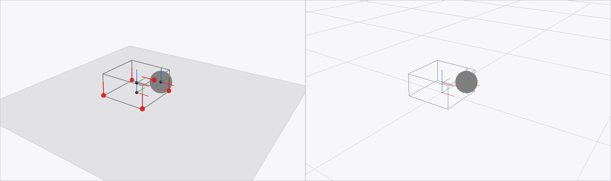
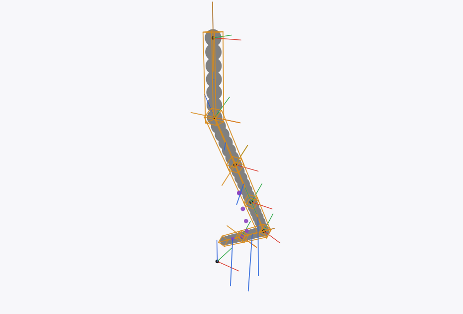
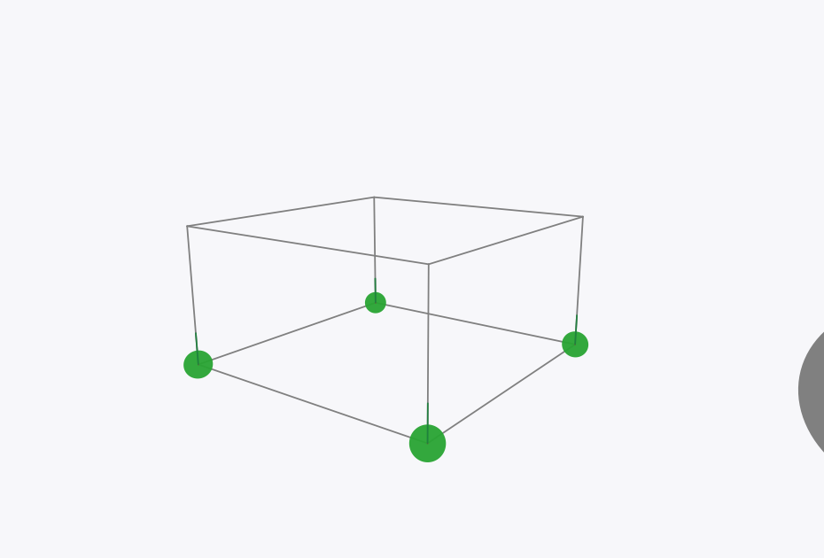

# mjc-viz — the live viewer

Status: **V0–V2 are in, and V3's log** — `viz/lib` (scene IR, still backend,
joint control, overlays, run log), `viz/bin/mjc-view` and
`viz/window/mjc-window`, which records and replays runs. V3's contact detail
and V4 (browser) are next. Companion to [`MILESTONES.md`](MILESTONES.md)
(engine plan) and [`PLAN.md`](PLAN.md) (design note). Milestones here are
`V0`–`V5`; engine milestones are `M0`–`M11`.

## 0. What the viewer is for

The viewer exists to answer "is the physics right?" while the engine is being
built, and "is the model doing what I think?" while it is being used. It is a
debugging instrument, not a renderer product. That decides almost everything
below: correctness of the picture matters more than its appearance, overlays
matter more than materials, and the thing must start in under a second on the
machine that is already running the physics.

The concrete questions it has to answer, in the order they come up:

| Question | Overlay | Milestone that needs it |
| --- | --- | --- |
| Are the body poses right? | body frames, joint axes, geom outlines | M1 |
| Is the mass matrix right? | inertia boxes, centre of mass | M2 |
| Is the solver right? | contact points, normals, penetration depth, per-row `λ` | M3–M4 |
| Is the model doing something stupid? | velocity vectors, energy, trail | M4 |
| Did the run diverge, and when? | log replay, step back, scrub | M4 onward |
| Which environment in the batch failed? | batch grid, selection | M7 |

A viewer that only draws filled shapes answers none of these. Half of the work
below is the overlay layer, and it is worth budgeting as such.

## 1. Requirements

Hard:

- 30 fps or better at 960×540 with 64 geoms and 200 overlay arrows, on
  integrated graphics; 60 fps at 1280×720 where a GPU is present.
- Orbit, pan and zoom with the mouse; a "look at this body" camera.
- Draw sphere, capsule, cylinder, box and plane, which is `PLAN.md` §8's v1
  geom set. Meshes are M8.
- Draw arrows and text in 3D and in screen space (labels, HUD).
- Work from `Model.t` and `Data.t` with no per-frame host round trip beyond
  one copy of the pose arrays.
- Pause, single-step and reset, driven from the keyboard.
- Deterministic still frames for docs and tests, without a display.
- Headless CI: no window in `runtest`.

Soft:

- Work over SSH or on a remote training box (browser backend, V4).
- Replay a recorded run and scrub (V3).
- Several environments side by side (V5).
- No GPU required: Mesa's software rasteriser is the fallback.

Explicitly not required: shadows, materials, PBR, transparency sorting,
level-of-detail, mesh import, text layout, picking beyond "which geom is
under the cursor", and a GUI toolkit.

## 2. Why not reuse `geom.viz`

`geom.viz` is the right answer for stills and movies, and the wrong answer for
a live viewer. Three structural reasons, in order of importance:

1. **It has no window.** It renders a page to PNG, SVG, PDF or an RGBA
   tensor. A live view would encode a PNG per frame and shell out to a player,
   or need a windowing layer anyway. The window is the part we do not have.
2. **It has no depth buffer.** `geom.viz` uses a painter's algorithm with one
   depth key per primitive. That is adequate for diagrams; it is wrong for a
   robot standing on a floor with its feet inside a contact, and it cannot
   draw the interpenetrations that a physics debugger exists to show.
3. **It rasterises 2D vector paths through `hugin.vg`,** with coverage-based
   antialiasing, and the reference camera builds a view ray and a multivector
   meet per projected point. Both are fine at a few frames per second and at
   640×360; neither is designed for 1280×720 at 30–60 fps.

The claim in (3) is reasoning, not measurement: `geom/VIZ.md` §9 lists frame
time as a test to run, and it has not been run. The first task of V0 is to
measure it, on a scene with 30 primitives at 1280×720, and record the number.
If it comes in under 15 ms per frame, that changes V1's backend choice and
this section gets an update. Points (1) and (2) stay true regardless.

What `geom.viz` is genuinely good at, and should keep doing:

- publication stills: SVG and PDF with real vector output;
- movies for talks, through `ffmpeg`;
- images for the README and for tests that compare a picture, not a number;
- a scene model that has already solved the "GA object → picture" adapters.

So V0 uses it, behind the same scene IR as the interactive backend. That is
also how the offline path stays honest: if a bug is visible in the window and
not in the still, the scene IR is wrong, not the physics.

## 3. Options

Scores are for this job: a live, debug-oriented viewer for a physics engine in
an OCaml monorepo that already pins Raven, Nx, Rune and Hugin.

| Option | What it gives | Cost | Deps | Verdict |
| --- | --- | --- | --- | --- |
| **`raylib`** (OCaml bindings, 2.x; pin the exact version at V1) | window, input, 3D camera, `DrawSphereEx`, `DrawCapsule3D`, `DrawCylinderEx`, `DrawCubeV`, `DrawLine3D`, `DrawGrid`, 3D text, `DrawTexture`; `raygui` bindings for sliders | ~600–900 lines of OCaml for the full v1 feature set; C library built from source by opam | bindings MIT, raylib and GLFW zlib, OpenGL 3.3, X11/Wayland | **chosen for V1** |
| `tsdl` + `tgls` | SDL2 window/input, raw GL 3/4; full control, instancing, custom shaders | ~1200–1800 lines (shaders, VAOs, buffers, font); two more concepts to own | SDL2, OpenGL | fallback if raylib is rejected, or if impostor rendering is needed later |
| `tsdl` + `hugin.vg.raster` | SDL2 window, upload the RGBA tensor from `geom.viz` as a texture | 300 lines, but inherits the painter's algorithm and the 2D rasteriser | SDL2 | V0's escape hatch if raylib is rejected; not 60 fps |
| `bogue` | SDL2 GUI with sliders, buttons, timelines | a GUI toolkit around a renderer we still have to write | SDL2 | optional for V3 controls, not a renderer |
| browser + three.js over WebSocket | real 3D, camera controls, works over SSH, decoupled frame rate, multiple clients | ~400 lines OCaml server + ~350 lines JS client + a protocol to own | `httpun-ws-eio` + `eio` (new to this repo) | **chosen for V4**, not v1 |
| `wgpu-ml` | WebGPU bindings, native and web | early bindings, extra native layer | wgpu-native | revisit in a year |
| Rerun | ready-made 3D viewer, timeline, remote | no OCaml SDK; the protocol is Rust-side and moves | Rust/C++ | not now |
| own renderer in Nx/Rune | stays in the stack, deterministic, `vmap`-able, GPU-able later | per-pixel SDF evaluation over `[h; w; ngeom]`: 640×360×64 is 59 MB per intermediate before tiling; a week or two to get right | none | interesting, not first |
| MuJoCo's `simulate` on our MJCF | zero work | the model must go back through MuJoCo, so it cannot show our bugs | MuJoCo | a development crutch only |
| terminal (`notty`) | zero deps | not 3D | none | no |

What decided the table.

**The engine's shapes are simple.** A physics scene is 20–100 instances of
five primitives plus line overlays. There is no need for a scene graph, a
material system, or a shader. Raylib's immediate-mode drawing is exactly this
shape, and its whole 3D API is a page long. The engineering budget belongs in
the overlays and in the log replay, not in a renderer.

**Depth correctness is not optional.** This is what removes `geom.viz` from
the list even though it is already in the repo: the painter's algorithm cannot
show a box sinking into a plane, which is the first thing anyone looks at.

**The browser is the answer to "online", not the answer to "live".** An
interactive native window is the cheapest way to sanity-check physics while
sitting at the machine. A browser viewer is the cheapest way to watch a run on
a cluster from a laptop, and it costs no native dependency. They are different
jobs and the scene IR makes the second one cheap later.

## 4. Recommendation

Build one neutral scene description and two backends, in this order:

```
   Model.t + Data.t
         |
         v
   Mjc_viz.Scene          pure OCaml, no graphics deps, unit-tested
         |
   +-----+-------------------------------+
   |                                     |
   v                                     v
 Mjc_viz.Geom (V0)                  Mjc_viz.Raylib (V1)
 geom.viz -> PNG/SVG/PDF/MP4        window, 60 fps, input
         |                                     |
         +-----------------> Mjc_viz.Web (V4) <+
                             three.js over ws
```

- **V0, no new dependency.** Still frames and movies through `geom.viz`
  (`hugin.vg` is already in the lock). This exists so that docs, README
  figures and CI screenshots never depend on a windowing library, and so the
  scene IR has a consumer from the first week.
- **V1, one new dependency: `raylib`.** The interactive window. This is the
  milestone that makes every later engine milestone checkable by eye.
- **V4, one new dependency: `httpun-ws-eio` (and `eio`).** The browser
  backend, after M6, when there is something worth watching from elsewhere.

The core `mjc` library never depends on any of this. The viewer lives in
`packages/mjc/viz/` as the `mjc.viz` sublibrary (V0 and the scene IR) plus
separate libraries/executables per backend, so `mjc` stays a physics library
that happens to ship a viewer.

### 4.1 Dependency requests

These need approval under `AGENTS.md` ("never add a dependency without
asking"). They are listed here with what they buy and what happens if they are
refused.

**Status: `raylib` is approved for V1** (repository owner, 2026-11-03). The
browser backend's `eio`/`httpun-ws-eio` request is still open and is decided
at V4.

| Request | For | Buys | If refused |
| --- | --- | --- | --- |
| `raylib` (+ its vendored C raylib, GLFW, OpenGL headers) | V1 | a native window in ~900 lines, with 3D primitives, a camera and text already written | V1 falls back to `tsdl` + RGBA blit from `geom.viz` (slow, but interactive), or the viewer is V0 only |
| `httpun-ws-eio`, `eio` | V4 | the browser backend, no C dependency | no remote/online viewer; V0 stills and V1 window only |

`raylib` is a C dependency with a build step (opam builds raylib from source
and needs the OpenGL/X11 headers). It is not used by the core, not linked into
`mjc`, and never touched by CI. If a C dependency of any kind is unacceptable,
the honest fallback is `tsdl` (still C) or a pure-OCaml software rasteriser
(§3, last row), and the viewer becomes a 5–10 fps preview rather than a tool.

## 5. The scene description

`Mjc_viz.Scene` is a snapshot, not a scene graph. A frame is a list of placed
shapes plus overlays; rebuilding it costs microseconds and keeps `vmap`,
`grad` and the viewer from needing to know about each other.

```ocaml
(* packages/mjc/viz/lib/scene.mli, sketch *)

type vec3 = { x : float; y : float; z : float }
type quat = { w : float; x : float; y : float; z : float }
type color = { r : float; g : float; b : float; a : float }

type shape =
  | Sphere of { center : vec3; radius : float }
  | Capsule of { a : vec3; b : vec3; radius : float }
  | Cylinder of { a : vec3; b : vec3; radius : float }
  | Box of { center : vec3; rot : quat; half : vec3 }
  | Plane of { normal : vec3; offset : float }   (* drawn as a grid patch *)

type layer = Geom | Overlay | Annotation

type item = {
  id : int;                  (* geom index: diffing, picking, selection *)
  shape : shape;
  color : color;             (* geom_rgba when the model carries one *)
  layer : layer;
}

type arrow = { tail : vec3; tip : vec3; color : color; width : float }
type label = { at : vec3; text : string }

type camera = {
  eye : vec3;
  target : vec3;
  up : vec3;
  fovy : float;
  ortho : bool;
}

type t = {
  time : float;
  camera : camera;
  items : item list;
  arrows : arrow list;
  labels : label list;
  stats : (string * float) list;   (* ncon, nefc, iterations, residual, fps *)
}
```

Construction is one pure function per concern:

```ocaml
val geoms : Model.t -> Data.t -> item list
val contacts : Model.t -> Data.t -> item list * arrow list
val forces : ?scale:float -> Model.t -> Data.t -> arrow list
val inertia : Model.t -> Data.t -> item list
val com : Model.t -> Data.t -> item list
val trails : Model.t -> Data.t list -> item list

val frame :
  ?contacts:bool -> ?forces:bool -> ?inertia:bool -> ?com:bool ->
  ?trails:Data.t list -> camera:camera -> Model.t -> Data.t -> t
```

Rules that keep the IR useful:

- **Host floats, not `Nx` tensors.** A frame is read once per display frame,
  not per physics step. `Scene.frame` converts `xpos`/`xquat` with one
  `Nx.to_array` per array; there is no per-shape `Nx.item`.
- **Ids are geom indices.** They let the browser backend diff, and they let a
  later picking click map back to `geom_id` and `body_id`.
- **Colours come from the model** (`geom_rgba`) when it has them, so a scene
  looks like the same scene in MuJoCo and in mjc. A palette is the fallback.
- **Layers, not depth.** Solids first, then overlays, then annotations. A
  backend with a depth buffer ignores the order; a backend without one uses
  it.
- **Nothing here knows about a backend, a camera track, or input.** Camera
  state lives in the executable.

## 6. Coupling to the simulation

Four modes, in increasing distance from the engine:

| Mode | Who owns the loop | Use |
| --- | --- | --- |
| `view` | the viewer | stepping a model by hand; a demo; a paper figure in motion |
| `attach` | the caller's loop | a training or optimisation loop in the same process |
| `follow` | a writer, in another process | a run on a cluster; "what happened at step 40 000" |
| `serve` | the caller's loop, browser client | watching from another machine (V4) |

`view` and `attach` share one rule: **decouple the physics rate from the
display rate**. The step advances by a fixed `dt` in an accumulator and is
called as many times as needed per display frame (or not at all); the display
never changes `dt`. For `attach`, the simulation publishes an immutable
`Scene.t` into an `Atomic.t`, and the viewer renders the latest one at its own
speed. Converting the poses happens on the simulation thread, because that is
where the `Nx` values live; the published snapshot is plain OCaml floats, so a
second `Domain` can read it without touching an `Nx` handle. Frames are
dropped, never queued.

`follow` needs a log. The format is fixed-stride binary, so the viewer can
seek without parsing:

```
header:  magic, version, model hash, shape key, nbody, nconmax, nefcmax,
         stride bytes; the frame count is the file length over the stride
record:  step:i64  time:f64  ncon:i32  nefc:i32
         xpos[nbody;3]:f64  xquat[nbody;4]:f64
         xipos[nbody;3]:f64                 (for the inertia and COM overlays)
         contacts[nconmax;9]:f64            (pos3, normal3, dist, force3)
```

A record is written by an async writer thread that drops frames rather than
blocking the sim; the viewer renders the newest complete record while an
earlier frame is being written (a two-buffer ring). Reading is a positioned
read at `index × stride`, so scrubbing is a jump, not a replay. One file per
run, named by model hash and start time, in `runs/`. A log is also what a
failing nightly test attaches. The full constraint set is not in the log: a
replay from the model recomputes it, which is the point of keeping the model
hash in the header.

## 7. The browser backend (V4)

Server side: a small HTTP server that serves one static page and upgrades to a
WebSocket. Messages are JSON, server to client only, except for a client
hello and an optional pick request:

```
-> {"op":"hello","version":1}
<- {"op":"model","hash":"...","nbody":17,"names":["torso", ...]}
<- {"op":"frame","t":1.234,"items":[{"id":3,"k":"capsule","a":[..],"b":[..],"r":0.05,"c":[..]}, ...],
                    "arrows":[...],"labels":[...],"stats":{...}}
<- {"op":"camera","eye":[...],"target":[...],"fovy":0.8}
```

The client is one self-contained HTML file with `three.js` (a pinned copy in
`packages/mjc/viz/web/assets/`) that builds meshes for the five primitive
types once, then updates transforms per frame. Bandwidth at 30 Hz for 64
geoms is a few tens of kB/s on localhost. The camera is client-side; the
server only sends it so a screenshot and a figure use the same view.

Why this is worth 1.5 weeks at V4 and not a day at V0: the JS asset has to be
vendored, licensed, pinned and tested, the protocol has to survive a version
bump, and a browser viewer with no test is a viewer that rots. At V4 the model
surface is stable and the log format exists, so the client can be driven from
a recorded log in a test.

## 8. Milestones

### V0 — stills and movies through `geom.viz` (0.5 week, at M0)

- `viz/lib/` with `Scene` and its tests; `viz/geom/` with the mapping to
  `Geom_viz.Primitive` and `Geom_viz.Draw`.
- `mjc-view --shot out.png --model M.mjcb --fixture f.mjbin --step 0` renders
  a single frame; `--movie out.mp4 --duration 2` renders a sequence through
  `Geom_viz.Movie`.
- **First task: measure `geom.viz`.** Time per 1280×720 frame for a scene with
  a plane, 24 primitives and 100 points, through the painter's algorithm.
  Record the number in this document. The V1 backend choice is revisited if
  it lands under 15 ms.
- Acceptance: the scene IR tests pass with no display; a golden PNG for a
  fixed model and camera is byte-stable across runs on the same machine;
  `--movie` produces an MP4 whose duration `ffprobe` reports; a scene with
  every v1 geom type renders and contains each shape's colour.
- Exit: a figure in the README, generated by a command, plus the measurement.

**V0 status: done, with the measurement it asked for.** `viz/lib/scene.ml` is
the IR the note wanted: host floats in world coordinates, shapes resolved from
the geom's pose and size — a capsule carries its two endpoints, a box its
centre, axes and half-extents — so a test reads it without a display and a
backend can be swapped without touching the translation from `Mjc.Data`.
`viz/lib/render.ml` is the `geom.viz` backend, and `viz/bin/mjc-view` writes a
PNG or an SVG with `--frames`, `--contacts` and `--forces` overlays.

The measurement: **105.8 ms per frame at 1280×720** for the `blocks` scene
(plane, box, sphere, five contacts, body frames), including PNG encoding, on
the development machine. That is over the 15 ms the backend choice was
conditional on, so the painter's algorithm is a still-image backend and not a
live one — which is what V1's window is for. (The 105.8 ms is rasterise *and*
encode; the split has not been measured separately.)

Figures: `doc/figures/viewer-v0-blocks.png`, regenerated by

    mjc-view --model test/fixtures/blocks.mjcb --width 1280 --height 720 \
      --contacts --frames --shot doc/figures/viewer-v0-blocks.png

### V1 — the interactive window (1 week, at M2)

- `viz/raylib/` with the window, orbit/pan/zoom camera, fixed-step loop, and
  the key map (`space` pause, `.` step, `r` reset, `g` grid, `f` frames,
  `c` camera reset).
- Joint control: number keys select a joint, `[`/`]` move it, `0` zeroes it.
  This is the FK debugging tool: move a joint, watch a link.
- Acceptance (manual, recorded in `doc/log.md`): 30 fps at 960×540 with a
  30-geom model on the development machine; 64 geoms at 1280×720 on a GPU;
  orbit and zoom with no allocation per frame; a `--shot` from the same camera
  matches the V0 still to within the backend's antialiasing.
- Acceptance (automatic): `mjc-view --check --frames 3` runs the backend
  headless under `xvfb-run` if a display library is present, and skips
  cleanly otherwise.
- Do not put the window in `runtest`.

**V1 status: done.** `viz/window/window.ml` is the loop: fixed step,
orbit/pan/zoom, `space`/`.`/`r`/`c`/`g`/`f`/`n`/`x`/`h` keys, joint control, a
HUD, and all drawing from `Mjc_viz.Scene` so the window and the stills show the
same picture. `mjc-window --check` runs three frames and writes a screenshot,
and checks the bytes are a PNG.

Getting raylib into the lock took declaring a package: this workspace resolves
libraries from `dune.lock`, and `dune pkg lock` only resolves what some package
`depends` on. `dune-project` now declares the `mjc` package (the library stays
private until M7; the package exists so the lock can resolve the viewer) with
`base`, `nx` and `raylib`. The relock moved 22 lock files by one line each —
dune's own build-rule encoding catching up, no version changes — plus the new
`raylib.2.4.0`.

The binding splits into `raylib.core` (window, input, camera, colour),
`raylib.models` (3D shapes) and `raylib.text`, so `window.ml` aliases them as
`RC`, `RM` and `RT`. `Camera3D` is a Ctypes structure: the camera is read
through the accessors and written back with a fresh `Vector3`, which is why
orbit and pan look the way they do.

**Joint control lives in `Mjc_viz.Controls`, not in the window.** Writing a
`qpos` coordinate and re-running kinematics is the interesting half, and it is
a pure function of a model and a state, so it is tested without a display: six
tests cover the ranges the model declares, the clamp at a limit, the links
following a hinge (the capsule's midpoint lands where a rotation by hand puts
it), one keystroke, the reference position, and that a free joint is refused by
kind rather than moved by a guess.

**The camera is the still backend's.** `Scene.framing` is the one definition of
the opening view — the centre of the drawn geometry, excluding planes, with the
eye offset by the box's largest side — and both backends call it. With no
arguments at all, the window and `mjc-view` now frame a model the same way.

**The camera is the still backend's, part two.** The first window shot showed the whole
scene collapsed at the origin, because `Data.create` leaves every derived
array at zero and the window never ran the forward pass the stills tool runs.
The state it opens on — and the one `r` resets to — is now
`Forward.forward m (Data.create m)`. With that fixed, the two backends agree on
where things are: **the sphere's centroid lands within 0.4 px** of the still's,
at the same camera and the same 1280×720 page, and its radius agrees to about a
pixel, which is what antialiasing costs.



Left: `mjc-view --frames --contacts` (painter's algorithm, filled plane).
Right: `mjc-window --body-frames --no-grid` (depth buffer, plane as a grid).
Same camera, same state. The differences are the ones expected from the
backends: the window occludes the box's far edge behind the sphere and shows
the plane through it.

**Frame times, measured with `--bench`** (AMD Radeon 8060S, Mesa 26.2.5, so
this is a GPU and not llvmpipe):

| Scene | Page | ms/frame | fps | of which scene build |
| --- | --- | --- | --- | --- |
| `blocks` (3 geoms, plane + box + sphere) | 960×540 | 2.82 | 355 | 0.003 ms |
| `bench64` (65 geoms, 195 body-frame lines) | 960×540 | 14.59 | 69 | 0.008 ms |
| `bench64` | 1280×720 | 14.76 | 68 | 0.008 ms |

That misses §9's "< 10 ms on llvmpipe" line by half, and the shape of the
numbers says why: 3 → 65 primitives costs 12 ms while 960×540 → 1280×720 costs
0.2 ms, so this is per-primitive CPU work, not fill. raylib's `DrawSphereEx`
re-tessellates its sphere on the CPU on every call. The scene build is 0.008 ms
of it, so the IR is not the problem. Two ways out when 64-geom models become
the normal case: cache one sphere and one capsule mesh and draw them with
matrices (65 draw calls, no tessellation), or `draw_mesh_instanced` per colour.
`bench64` is committed (`viz/window/bench64.xml` and its `.mjcb`) so the number
can be re-taken.

What V1 asked for and did not get: the "no allocation per frame" acceptance is
unmeasured (the loop allocates the HUD string and the scene's lists, which is
per frame but small; a GC counter would settle it), and the still-versus-window
comparison is a centroid measurement and a picture rather than a per-pixel
diff, because the two backends antialias differently and one paints a filled
plane where the other draws a grid.

### V2 — dynamics overlays (0.5 week, at M2)

- Inertia boxes, centre of mass, joint axes, velocity arrows, a trail of body
  origins, an energy/time HUD.
- Acceptance: overlays are pure functions of `Model.t`/`Data.t` and tested as
  such; each can be toggled; the inertia box of a known box geom matches its
  `geom_size` and the mass matrix test's numbers.

**V2 status: in, less the trail.** `Scene.inertia_boxes`, `Scene.subtree_com`,
`Scene.joint_axes`, `Scene.velocities` and `Scene.mechanical_energy` are pure
functions of a model and a state; `Scene.of_state` takes a flag per layer and
leaves the others empty, so a backend draws the record without a case for
absent. Both backends draw all five, and the window toggles them with `i`, `m`,
`j`, `v` and `e`.

The numbers the acceptance asks for are tests, not pictures:

- **Inertia boxes.** A box geom's inertia box comes back as itself — the crate
  in `blocks` is `0.2 x 0.2 x 0.1` and its box is too, to 1e-12 — and a sphere's
  is `r sqrt(3/5)` on every axis, which is what the closed form gives. The
  half-extents are `h_x^2 = 3/(2m)(I_y + I_z - I_x)`, MuJoCo's own viewer
  formula; a non-physical inertia clamps at a hair instead of turning inside
  out.
- **Centre of mass.** The world body's `subtree_com` agrees with the
  mass-weighted mean of the bodies', computed by hand in the test; a leaf's is
  its own.
- **Joint axes.** The `limited` model's hinge comes back at `(0,0,1)` along
  `+y` and its slide at `(0,0,0.4)` along `+x`, as the model declares.
- **Velocities.** With the shoulder at 1 rad/s, the arm's centre of mass 0.3
  below the anchor moves at 0.3 m/s along `-x`. The velocity is the Jacobian of
  the point times `qvel`, not `cvel`: the engine's `cvel` is com-based over a
  body's *subtree*, so composing it down a chain needs a shift that is easy to
  get subtly wrong — and the first version of this code did get it wrong.
- **Energy.** The per-body sum `1/2 m |v|^2 + 1/2 w'Iw` equals `1/2 qvel'M qvel`
  to 1e-9 on `floating`, `limited`, `chain6` and `looped`. That equality is the
  test, because the sum exists only to avoid building the mass matrix at display
  rate: the matrix route cost **2.6 ms per frame** on a 65-body model, and the
  sum costs nothing measurable.



`mjc-view --model chain6.mjcb --steps 40 --inertia --com --joint-axes
--velocity --frames` at step 40; the window draws the same layers from the same
`Scene.t`.

Not done: the **trail**. A trail is a function of *history*, not of a state, so
it belongs to whoever owns the loop (the window) rather than to `Scene`; it will
be cheaper to add with V3's log, where the history already exists.

### V3 — contacts, forces, and replay (1 week, at M4)

- Contact points as spheres, normals as arrows, penetration depth as colour,
  per-row `λ` as bars, friction cone as a 2D fan in the contact frame.
- `--log run.mjlog` writer, `--follow` reader, scrub and step in the log; a
  "diverged at step N" jump.
- Playback controls, with `raygui` sliders if approved, otherwise key bindings
  and a text HUD.
- Acceptance: a log round-trips (write, read, identical frames); seeking to
  any index is O(1); a 100 000-step log replays at 60 fps; the contact overlay
  of a known two-box scene has the right count, position and normal sign
  (compared to the fixture, not to the picture).

**V3 status: the log is in; the contact detail is not.** `viz/lib/log.ml`
writes and reads a run, and the window records with `--log` and replays with
`--follow` — `space` plays or pauses, the arrow keys scrub, `home`/`end` jump,
`.` steps one frame. The HUD of a replay shows the record's time and counts,
not the idle state's, which is a thing that was wrong first.

The format is fixed-stride little-endian doubles: a 96-byte header (magic,
version, `ngeom`, `nconmax`, stride, the model's name) and then one record per
frame holding the world poses of every geom, the contact points, normals,
distances and forces. Geom poses rather than joint positions, so a replay needs
no kinematics and a reader cannot disagree with the writer about a model it
does not have. A record is written whole or not at all, so a reader racing a
writer sees the previous frame or the next one.

What is measured, and by what:

| Claim | How it is checked | Result |
| --- | --- | --- |
| a log round-trips | every recorded number compared to the state it came from, bit for bit | `test_log.ml`, 40 frames |
| a replay frame is the live frame | `Log.scene` vs `Scene.of_state` at the same step: geom names, contact count, points, normals | `test_log.ml` |
| seeking is O(1) | 500 pseudo-random reads out of an 800-frame log, in a different order than they were written | **< 0.5 s**, and the test fails if it becomes a scan |
| writing is cheap | 300 frames with and without `--log` | **0.08 ms/frame** (budget 0.1) |
| reading is cheap | the scene build of a replay frame | **0.002 ms** |
| replay is draw-bound | `--bench` in `--follow` mode, `blocks` at 1280×720 | **0.15 ms/frame**, against 2.78 ms for the same model stepped live |

The 100 000-step case is not recorded here because the number that would matter
is the *draw*, which does not depend on the log: a replay frame costs the same
as a live frame with the same geometry, and the §9 table already prices that
(`blocks` 0.15 ms, the 65-geom budget model 14.6 ms). What the log adds is
0.002 ms of read.

**And "did it diverge, and when?"** `Log.divergence` scans a finished log for
the first frame whose geometry is not finite or is more than a kilometre out;
the window computes it once when the log is opened, says `diverged at 100 (d)`
in the HUD, and `d` jumps there. The test patches one record of a clean log to
a thousand kilometres and expects the index back, which also checks that the
record layout is the one the header advertises.

**The contact detail is in too.** A contact is now drawn as the solver sees it:
the point coloured by penetration, the normal arrow scaled by the normal force,
the friction force in red, and — for a contact with friction rows — the
pyramid's four edges as the cone it is.

That needed the contact's *frame*, which `mjData` has and our `Data` did not:
`contact_frame`, three rows of normal then two orthonormal tangents, written by
the collision pass from the same `mju_makeFrame` it already used for the
pyramid rows. The fixture now records it, so the tangents are checked against
the C engine at 1e-12 like every other contact array — the test lives in
`test_contact.ml` beside `contact_pos` and `contact_normal`.

The force decomposition follows the rows: the normal force is the sum of the
contact's rows, and what the pyramid's edges leave after cancelling along the
normal is the friction force, `mu [(f0 - f1) t1 + (f2 - f3) t2]`. It is the
solver's own arithmetic, not a re-derivation from the state, which is why a test
can hold it to invariants that would otherwise be approximate:

| Claim | Check | Result |
| --- | --- | --- |
| the contacts carry the weight | `blocks` settled, sum of contact forces vs `(m_crate + m_ball) g` | **313.9 N**, to 1e-3 |
| the frame is a frame | normal and both tangents unit, mutually orthogonal, on every contact | 1e-9 |
| Coulomb holds | `|force_t| <= mu force_n + 1e-9` on every pyramidal contact | ✓ |
| a frictionless contact has no friction | `dim = 1` contacts have zero `tangent_force` | ✓ |
| depth reads as colour | green at contact, amber in between, red at a centimetre, monotone | `test_depth_colour` |



`mjc-view --model blocks.mjcb --steps 200 --contacts` at a close camera: four
contacts, 78.48 N each, coloured green because 0.11 mm of penetration is
nothing.

The numbers underneath, read back out of a log: the four crate contacts carry
**78.48 N** each against a 313.9 N weight, at **0.11 mm** of penetration, and
the ball's one contact carries **29.96 N** at 0.37 mm — which is the crate's and
the ball's weight to three figures, so the overlay is showing the solver's
numbers and not a plausible-looking rescaling of them.

Still not met: the `two-box` acceptance ("right count, position and normal
sign"), which needs box-box collision from M4. Per-row `λ` *bars* are also not
drawn: the arrows carry the same information in the normal and tangential
directions, and a bar per row would be four lines per contact saying what one
arrow already says. That is a judgement, not an oversight, and it changes when
a row disagrees with its neighbours — which is exactly the bug the bars are for,
so it may come back.

### V4 — browser backend (1.5 weeks, at M7)

- `viz/web/` server + vendored `three.js` client, protocol versioned.
- Acceptance: a headless test drives the protocol with a recorded log and
  asserts the JSON messages; a browser screenshot is checked by hand once per
  release; the client renders a 1000-frame log at 30 Hz.
- Gate: only if the `eio`/`httpun-ws-eio` dependency is approved, and only if
  someone actually watches runs remotely. Otherwise V4 is cancelled and the
  log plus V0 stills are the answer.

### V5 — batch and polish (0.5 week, at M7)

- Grid of `B` environments from a vmapped `Data`, one pane each or a shared
  camera; ghost trajectories for iLQR iterates; a selection outline; a
  screenshot command used by the docs.
- Acceptance: a 16-pane grid at 30 fps with `B = 16` and `nv = 27`; the
  screenshots in `README.md` are generated by the command in the README.

## 9. Performance budget

What has to be true, and where it is measured:

| Item | Budget | Where |
| --- | --- | --- |
| `Scene.frame` for 64 geoms + 200 arrows | < 0.2 ms | unit benchmark in `viz/test` |
| one `Nx.to_array` of `xpos`/`xquat` per frame | one copy, < 0.05 ms | same |
| draw 64 primitives + 200 lines, 960×540 | < 10 ms on llvmpipe, < 3 ms on a GPU | `mjc-view --bench` |
| image upload for the geom backend | < 5 ms at 1280×720 | V0 measurement |
| log write per frame | < 0.1 ms, non-blocking | `bench/` |
| log seek | O(1) | V3 test |

The first two are the only ones that can regress invisibly, so they are the
ones with a test.

## 10. Open questions

1. **Does the lab want a viewer inside the training loop, or a separate
   process?** `attach` is 20 lines and needs a second `Domain`; `follow` needs
   a log format and is more useful on a cluster. Both are cheap; the log is
   the one that pays off later, so V3 builds it first.
2. **raylib or tsdl?** raylib is half the code for the same result and brings a
   camera and 3D text. tsdl is thinner and would let us blit an Nx-rendered
   image later. Recommendation: raylib for V1, and keep the scene IR so the
   choice can be revisited without touching the engine.
3. **Is a pure-OCaml software renderer worth having?** It would be
   deterministic, `vmap`-able and GPU-able with the rest of the stack, and it
   would remove the C dependency. The memory arithmetic in §3 says no for a
   full-frame SDF evaluation; a tiled version is a week of work with an
   uncertain payoff. Revisit after V1, not before.
4. **How much of MuJoCo's viewer look do we reproduce?** The value is in
   recognising the scene, not in matching pixels. Colours from `geom_rgba`,
   the same camera conventions (z-up, metres) and the same overlay names are
   enough.
5. **Browser asset maintenance.** A vendored `three.js` is a file to update
   and a licence to track. If that is unacceptable, V4 becomes a
   server-rendered image stream over plain HTTP, which is much simpler and
   much worse interactively.
6. **Screenshots in CI.** A golden image from `geom.viz` is deterministic;
   a golden image from raylib is not. Keep the golden images on the `geom.viz`
   backend only, and let the window backend be checked by hand.
