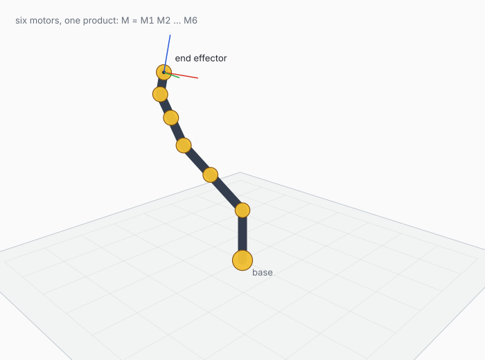

# geom-viz — rendering geometric objects and motor movies

`geom-viz` turns the objects of [`geom`](../README.md) into pictures. It renders
points, segments, polylines, polygons, circles, spheres, planes and coordinate
frames from a perspective or orthographic camera to PNG, SVG and PDF, and
renders animations to MP4 through the system `ffmpeg`.

It is a separate library (`geom_viz`, in [`lib/`](lib)) so that the algebra
package does not depend on a graphics stack. The renderer is
[Hugin](https://github.com/hennequin-lab/raven)'s vector-graphics layer
(`hugin.vg`, `hugin.vg.raster`, `hugin.vg.svg`, `hugin.vg.pdf`, `hugin.gg`,
`hugin.font`).

> **Status.** Experimental. The library has no `.mli` files and its API can
> change without notice. It uses a painter's algorithm, has no near-plane
> clipping, no shading and no text labels. The core `geom` library has complete
> interfaces.


*Cga objects adapted to primitives and rendered by geom-viz.*

## Contents

- [Install and run](#install-and-run)
- [The rendering model](#the-rendering-model)
- [A complete example](#a-complete-example)
- [Animations](#animations)
- [Adapters from geom](#adapters-from-geom)
- [Demos](#demos)
- [Limits](#limits)

## Install and run

`geom-viz` uses the `geom` library and Hugin's vector-graphics packages. The
project is developed inside the raven workspace; from `geom/`:

```sh
dune build
dune exec viz/demo/static.exe
```

The output of a demo is written relative to the current directory
(`viz/demo/out/`); those files are gitignored. The README figures are generated
by `../examples/figures.ml`:

```sh
dune exec examples/figures.exe
```

That writes the committed SVGs to `../doc/figures/` and PNG previews next to
them.

## The rendering model

A picture is built in four layers.

### 1. Neutral primitives

`Primitive.t` is a small geometric language that knows nothing about Clifford
algebras:

```ocaml
type p3 = { x : float; y : float; z : float }

type t =
  | Point of p3
  | Segment of p3 * p3
  | Polyline of p3 list
  | Polygon of p3 list
  | Circle of { center : p3; normal : p3; radius : float }
  | Sphere of { center : p3; radius : float }
  | Plane of { normal : p3; offset : float; patch : p3 list }
  | Frame of { origin : p3; x : p3; y : p3; z : p3 }
```

`p3` is a plain host-side record. The arithmetic helpers (`add`, `sub`,
`scale`, `dot`, `cross`, `norm`, `normalize`) are in the same module. A
`Plane` carries an explicit `patch` polygon, so the renderer draws a finite
piece of a plane rather than an infinite surface. A `Frame` is a coordinate
triad; its three axes are drawn red, green and blue.

The renderer consumes only this type. The algebra enters through the adapters
below.

### 2. A camera

`Camera.create` builds a pinhole camera:

```ocaml
let camera =
  Camera.create
    ~eye:(Primitive.p3 4. (-4.) 3.)
    ~target:(Primitive.p3 0. 0. 0.5)
    ~up:(Primitive.p3 0. 0. 1.)
    ~fov_y:(Float.pi /. 4.)
    ~width:800.
    ~height:600.
    ()
```

The camera has a perspective mode by default and an orthographic mode with
`~ortho:true`. `Camera.project camera p` returns `Some (x, y, depth)` in screen
coordinates (y down, origin at the top-left) or `None` when the point is behind
the camera or beyond `~near`/`~far`. Screen units are points; the page is
`width × height` points.

The camera is a classic look-at camera, not a projective-geometry object. A
future version may build the image plane and view rays with `Pga`; the current
path is the fast pinhole projection.

### 3. Entities and styles

An entity pairs a primitive with a style, a layer and a motion:

```ocaml
type style =
  { fill : Hugin_gg.Color.t option
  ; stroke : Hugin_gg.Color.t option
  ; width : float
  ; dash : float list
  ; opacity : float
  }
```

Three common styles:

```ocaml
Draw.default                                  (* blue fill, dark stroke *)
Draw.solid ~alpha:0.85 (Hugin_gg.Color.v 0.85 0.25 0.55)
Draw.outline ~width:2.0 ~dash:[4.; 4.] (Hugin_gg.Color.v 0.1 0.45 0.6)
```

`Draw.static` places a primitive in the scene. `Draw.moving ~motion` applies a
time-dependent motor to the primitive before drawing:

```ocaml
let motion t =
  Motor.mul
    (Motor.translate3 0. 0. (0.3 *. sin (2. *. Float.pi *. t)))
    (Motor.rotate
       ~axis:(Nx.create Nx.float32 [|3|] [|0.; 0.; 1.|])
       ~angle:(Nx.scalar Nx.float32 (2. *. Float.pi *. t)))

let sphere =
  Draw.moving ~layer:2 ~motion ~style:Draw.default (Primitive.of_cga_sphere s)
```

`Draw.moving_with ~motion` receives the time and the current primitive and
returns a new primitive. The arm demo uses it to recompute a kinematic chain
per frame instead of transforming a fixed object.

`layer` is an integer painter's key. Lower layers paint first. Inside a layer,
entities are sorted by depth and painted far to near. That is the whole hidden
surface algorithm.

### 4. A scene and a frame

```ocaml
let scene = Draw.create camera [ plane; sphere; frame ]
let picture = Draw.picture_at scene ~time:0.
let frame = Frame.create ~density:1.5 ~width:800. ~height:600. picture

let () =
  Frame.save_png frame "out.png";
  Frame.save_svg frame "out.svg";
  Frame.save_pdf frame "out.pdf"
```

`Frame.create` puts a picture on a page. `density` is the number of raster
pixels per point; use 1.5 or 2 for PNG. SVG and PDF are vector output and
ignore density. `Frame.rgba` returns the rendered page as an `Nx` tensor if you
want to process it further.

## A complete example

This renders one CGA sphere from a perspective camera:

```ocaml
open Geom
open Geom_viz
module P = Primitive

let () =
  let camera =
    Camera.create
      ~eye:(P.p3 3.5 (-3.5) 2.5)
      ~target:(P.p3 0. 0. 0.7)
      ~up:(P.p3 0. 0. 1.)
      ~fov_y:(Float.pi /. 4.)
      ~width:700.
      ~height:520.
      ()
  in
  let sphere =
    Cga.sphere
      ~center:(Nx.create Nx.float32 [|3|] [|0.; 0.; 0.8|])
      ~radius:(Nx.scalar Nx.float32 0.6)
  in
  let entity =
    Draw.static
      ~style:
        { Draw.default with
          fill = Some (Hugin_gg.Color.v 0.25 0.52 0.82)
        ; stroke = Some (Hugin_gg.Color.v 0.10 0.22 0.36)
        ; width = 1.6
        }
      (P.of_cga_sphere sphere)
  in
  let scene = Draw.create camera [ entity ] in
  let picture = Draw.picture_at scene ~time:0. in
  let frame = Frame.create ~density:1.5 ~width:700. ~height:520. picture in
  Frame.save_png frame "sphere.png";
  Frame.save_svg frame "sphere.svg"
```

The shape is built by `Cga`; the renderer only sees a sphere with a center and
a radius. That separation is the point of the primitive layer.

## Animations

A scene is a function of time. `Movie` renders frames and hands them to
`ffmpeg`:

```ocaml
let spec =
  { Movie.duration = 2.     (* seconds *)
  ; fps = 24
  ; scene
  ; density = 1.5
  }

let () = Movie.to_mp4 spec ~path:"out/sphere.mp4"
```

`Movie.to_mp4` writes a temporary directory of PNG frames, shells out to
`ffmpeg -framerate ... -i frame-%06d.png -c:v libx264 ...`, and removes the
directory unless `~frames_dir` is given. `ffmpeg` must be on `PATH`. The
encoder is deliberately outside the library; `Movie.render_png_sequence` gives
you the frames if you want another encoder or an image sequence.

The figures in the main README use the same scene model at a single time; see
[`../examples/figures.ml`](../examples/figures.ml).

## Adapters from geom

The adapters turn algebra objects into primitives. They extract the Euclidean
parameters from the multivector:

| adapter | source | extraction |
|---|---|---|
| `P.of_cga_point` | `Cga.point` | `Cga.coords` |
| `P.of_cga_sphere` | `Cga.sphere` | `Cga.sphere_center`, `Cga.sphere_radius2` |
| `P.of_cga_plane` | `Cga.plane` | `Cga.plane_normal`, `Cga.plane_offset` |
| `P.of_cga_line ?extent` | `Cga.line` | direction and moment; the closest point is `d × m` |
| `P.of_cga_circle` | `Cga.circle` | center, normal and radius |

`P.of_cga_line` draws a finite segment of half-length `extent` (default 2.5)
around the point of the line closest to the origin. A line is infinite; a
picture is not.

`P.transform motor primitive` applies a rigid motion to a primitive. It
transforms points with `Cga.apply_motor`; for a circle it rebuilds the normal
from two transformed points; for a plane it transforms the patch and rebuilds
the normal; for a sphere it moves the center and keeps the radius; for a frame
it moves the origin and all three axis endpoints. The argument is a `Motor.t`,
so the motion is always rigid. For a dilation or a transversion there is no
motor: sandwich the `Cga.t` and re-extract the primitive with the adapter, as
the `conformal` demo does.

There is no PGA adapter yet. A PGA object can be converted by extracting its
coordinates and line parameters and building primitives by hand; see the PGA
figure in `../examples/figures.ml`.

## Demos

Run from `geom/`:

```sh
dune exec viz/demo/static.exe      # still image: plane, sphere, circle, points, frame
dune exec viz/demo/movie.exe       # 2 s motor animation -> MP4
dune exec viz/demo/zoo.exe         # CGA objects, with a moving copy of each
dune exec viz/demo/arm.exe         # 6-DOF kinematic chain
dune exec viz/demo/conformal.exe   # dilation and transversion movies
```

| demo | output | shows |
|---|---|---|
| `static.ml` | `static.png`, `static.svg` | primitives, camera, styles, layers |
| `movie.ml` | `motor.mp4` | `Draw.moving`, frame sequence, `ffmpeg` |
| `zoo.ml` | `zoo.{png,svg,mp4}` | CGA adapters and motor animation |
| `arm.ml` | `arm.{png,svg,mp4}` | composed motors, `moving_with` |
| `conformal.ml` | `conformal-*.{png,svg,mp4}` | dense versors and re-extraction |

The output directory is `viz/demo/out/` (relative to `geom/`), deliberately
gitignored: demos write artifacts, not sources.



*A kinematic chain drawn from a product of six motors.*

Three README figures exercise the library end to end:
[the E3 product](../doc/figures/e3-products.svg),
[the CGA object zoo](../doc/figures/cga-objects.svg) and
[the PGA meet](../doc/figures/pga-meet.svg). The ScLERP figure is
[here](../doc/figures/slerp-screw.svg).

## Limits

- **No clipping.** A primitive is projected only if all its points are in front
  of the camera and inside the near/far range. A polygon that crosses the near
  plane disappears entirely. Keep the camera outside the scene and the scene
  inside the frustum.
- **Painter's algorithm.** Depth is one number per primitive, taken at a
  representative point. Intersecting surfaces and a line that passes through a
  sphere can sort incorrectly; split the object into pieces if it matters.
- **No shading.** Spheres are drawn as silhouettes with a flat fill. There are
  no lights, shadows or material models.
- **No text.** The scene language has no labels. The README figures overlay
  text in screen space with `Hugin_font.Font.outline` and `Hugin_vg.Picture`;
  see `../examples/figures.ml` for the pattern (`text`, `label`, `arrow2d`).
- **No `.mli`.** The interface is the implementation. Names and records can
  change. The main `geom` package has complete interfaces and is the part to
  build geometry on.
- **External encoder.** MP4 output needs `ffmpeg`; the library does not encode
  video itself.
- **Euclidean camera.** The camera is a pinhole model, not a PGA image plane
  and view-ray construction. The PGA camera path is planned in
  [`../VIZ.md`](../VIZ.md).
